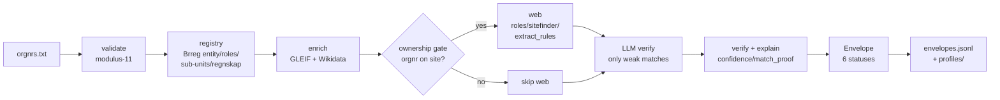

# Signalpost — Project Overview

**What it is:** Signalpost is an evidence-backed company-profile agent for Norwegian
organisation numbers, built for the **Builderr Signalpost hackathon**. You give it a
list of organisation numbers; it returns one **result envelope per input** — every
fact carrying a source link, retrieval date, verbatim quote, confidence score, and a
honest status. The thing being judged is the **working agent**, not the UI.

**Design rule:** *registry first, web second, LLM last.* Every field the register
already answers is never crawled, paid for, or modelled. A fact attached to the wrong
company is the one fatal error, so the agent would rather publish a gap than a guess.

---

## 1. Features

| Feature | What it does |
|---|---|
| **Evidence-backed profiles** | 28+ field types (identity, people, locations, financials, digital presence, identifiers). Every fact has `source_url`, `retrieved_at`, verbatim `evidence`, `match_proof`, `confidence`. |
| **Honest result envelope** | One output per input, never dropped. Six statuses: `available`, `not_available`, `not_applicable`, `ambiguous`, `blocked`, `failed`. Non-available statuses carry **no** speculative facts. |
| **Null, never zero** | An unfiled value stays absent; a genuinely filed `0` stays `0`. No fabricated numbers. |
| **People & roles** | CEO, board chair, board members, deputies, auditor, accountant — from Brreg `roller`, no birth dates. |
| **Locations** | Registered sub-entities (`underenheter`) → `location_count` + `business_locations`. |
| **Financials** | Latest filed accounts (revenue, result, assets, equity, debt) from Regnskapsregisteret; checksum-validated to the right company. |
| **Identifier enrichment** | GLEIF LEI + Wikidata (P2338) joined for cross-source proof. |
| **Delta / change tracking** | Re-validation detects field-level changes and appends `ChangeRecord`s (the synthesis score). |
| **Live data (Phase 0–2)** | Watches Brreg's change feed and keeps profiles current; pushes updates to the dashboard over SSE. See §4. |
| **Console UI** | Dependency-free static console + Next.js marketing/login/dashboard shell (mock "Nordic Robotics" data). |

---

## 2. Technology stack

### Core agent — Python 3, **standard library only** (keyless, one command)
| Concern | Choice |
|---|---|
| HTTP / cache / retry | `urllib` via `src/net.py` (polite, cached, robots-aware, budget-aware) |
| Registry data | **Brønnøysundregistrene** (Brreg) open APIs — Enhetsregisteret + Regnskapsregisteret, **NLOD 2.0, no API key** |
| Org-number validation | **modulus-11** checksum (`validate.py`) |
| Identifier join | GLEIF + Wikidata SPARQL |
| Envelope / diff | `src/envelope.py`, `src/delta.py` (stdlib) |
| Orchestration | `src/pipeline.py` (thread pool) + `src/score_local.py` |
| Serving | `src/serve.py` (zero-dep `http.server`) |

### Live layer — optional companion process (`requirements-live.txt`, separate venv)
| Phase | Technology | Repo |
|---|---|---|
| 0 — watchdog | stdlib `sched`/loop, `oppdateringsid` cursor | (no deps) |
| 1 — bridge | **FastAPI** + **Uvicorn** + **sse-starlette** (SSE) + **httpx** (async) + **aiolimiter** (rate limit) + **APScheduler** (cron) | github.com/fastapi, sysid/sse-starlette, encode/httpx, mjpieters/aiolimiter, agronholm/apscheduler |
| 2 — analytics | **DuckDB** (embedded SQL over JSONL) | github.com/duckdb/duckdb |
| 2 — fan-out | **redis-py** pub/sub (graceful no-op if `REDIS_URL` unset) | github.com/redis/redis-py |
| 2 — broker | **FastStream** scaffold (inert unless `FASTSTREAM_BROKER` set) | github.com/ag2ai/faststream |

### Frontend — Next.js 15 / React 19 / Tailwind / Framer Motion / Recharts
Landing page, Login (role select: Analyst / Auditor), and Dashboard shell built with
mock "Nordic Robotics" data. The dashboard subscribes to the live layer via native
`EventSource` (no extra npm dependency).

---

## 3. Workflow — the core evidence pipeline



Layer order and what each contributes (recall → precision → synthesis):
1. **Registry** — identity, people, locations, financials (free, high confidence, the bulk of recall).
2. **Web** — only entered via the ownership gate (a checksum-valid orgnr on the page); harvests only role mailboxes / switchboards, never personal inboxes.
3. **LLM** — used last, only to verify weak matches; never invents facts.

Output contract: `envelopes.jsonl` — **one JSON object per input**, the scorer reads it directly.

### Live-data workflow (Phase 0 → 1 → 2)

```mermaid
flowchart LR
    B[Brreg change feed\noppdateringsid cursor] --> I[INGEST\nhttpx + aiolimiter]
    I --> P[PROCESS\npipeline.run per changed orgnr]
    P --> D[DELIVER\nmerge envelope +\nappend ChangeRecord]
    D --> S[changes.jsonl]
    S --> W[SSE /api/stream/{orgnr}\nto dashboard]
    S --> R[(Redis pub/sub)]
    D --> Q[(DuckDB analytics)]
```

- **Ingest** — poll `oppdateringer/enheter` with the monotonic `oppdateringsid` cursor (Brreg is pull-only; no webhook exists).
- **Process** — re-run the existing pipeline for only the changed organisasjonsnummer(s).
- **Deliver** — merge the fresh envelope into `envelopes.jsonl` and append the detected change to `changes.jsonl`; the dashboard receives it over Server-Sent Events.

---

## 4. How to run

```bash
# Core agent (stdlib-only, keyless) — this is the judged artifact
python run.py run ORGNR_FILE=orgnrs.txt     # 100/100 result envelopes
python run.py score                          # local scorecard (50/30/12/8)
python run.py web                            # dependency-free console

# Live layer (optional, separate venv)
python src/live.py --once --limit 5          # one live tick (Phase 0)
python src/live.py --interval 60             # Phase 0 daemon
.venv-live/Scripts/python.exe -m pip install -r requirements-live.txt
.venv-live/Scripts/python.exe -m uvicorn src.live_api:app --port 8799   # Phase 1 + 2
# dashboard: new EventSource("/api/stream/<orgnr>")
```

---

## 5. Scoring alignment (Builderr rubric 50 / 30 / 12 / 8)

| Category | Weight | How Signalpost earns it |
|---|---|---|
| **Recall & coverage** | 50 | Registry-first breadth (people/locations/financials/identifiers) + live re-validation keeps coverage from rotting. |
| **Precision & evidence** | 30 | Every fact carries `source_url` + `match_proof` + confidence; null-never-zero; wrong-company guard fires before any publish. |
| **Synthesis** | 12 | `ChangeRecord`s populate the change stream; explanations cite evidence. |
| **Ease of use / UX** | 8 | One-command run, live SSE dashboard updates, clear envelope statuses. |

Qualification: total score ≥ **65/100**.

---

## 6. Files of note

```
src/            validate, registry, enrich, sitefinder, gate, extract_rules, extract_llm,
                verify, explain, delta, profiles, pipeline, score_local, net, serve,
                normalize, cli, coverage, envelope        # core (stdlib)
                live, live_api, analytics, fanout, eventbus  # live layer (phases 0–2)
runs/           envelopes.jsonl, changes.jsonl, watermark.txt
profiles/       one JSON profile per company
docs/           README.md, DATA_SOURCES.md, LIVE_DATA_STACK.md, PROJECT_OVERVIEW.md
web/            dependency-free console (original)
web-next/       the console that is actually served: index.html + app.js + styles.css
                (plain HTML/CSS/JS, no build step, no framework, no dependencies)
requirements-live.txt   live-layer deps (FastAPI stack + DuckDB/Redis/FastStream)
```

> **Honesty note:** the live layer and dashboard are force-multipliers on recall +
> synthesis. The competition is won by a correct, evidence-bearing agent — the UI and
> streaming are there to *show* the evidence, not to replace it.
